# Manutenção industrial: o que os dados de MES e SAP revelam

Estudo de dados sobre as paradas de quatro máquinas (**A**, **B**, **C** e **D**) entre **janeiro e junho de 2026**, cruzando dois registros do mesmo problema que nunca tinham sido comparados:

- **MES**, o "diário de bordo" da **Produção**: quando a máquina parou, quando voltou, qual equipamento e qual componente;
- **SAP**, a "agenda de serviços" da **Manutenção**: ordens de serviço com tipo, texto curto e horário do trabalho.

Este documento reúne **apenas os resultados e as conclusões**. A metodologia completa, com cada decisão explicada, está nos notebooks em [`src/`](src/).

> **Sobre as máquinas.** A máquina **A** é o ativo real e o foco do estudo. As máquinas **B, C e D** se comportam como dados simulados: servem de referência e de "caso de teste" para os métodos. As conclusões de engenharia valem para a **máquina A**.

> **Para mais informações sobre a metodologia:** veja o relatório técnico em [`src/relatorio_tecnico.pdf`](src/relatorio_tecnico.pdf).

---

## Sumário

- [Manutenção industrial: o que os dados de MES e SAP revelam](#manutenção-industrial-o-que-os-dados-de-mes-e-sap-revelam)
  - [Sumário](#sumário)
  - [1. Resumo executivo](#1-resumo-executivo)
  - [2. Qualidade das bases](#2-qualidade-das-bases)
  - [3. Conciliação MES × SAP](#3-conciliação-mes--sap)
    - [3.1 Resultado geral](#31-resultado-geral)
    - [3.2 O vocabulário aprendido para a máquina A](#32-o-vocabulário-aprendido-para-a-máquina-a)
    - [3.3 Por que os eventos não conciliam](#33-por-que-os-eventos-não-conciliam)
    - [3.4 Divergências de horário](#34-divergências-de-horário)
    - [3.5 A linha do tempo de um evento](#35-a-linha-do-tempo-de-um-evento)
    - [3.6 Confiabilidade da conciliação](#36-confiabilidade-da-conciliação)
  - [4. Retrato de cada máquina](#4-retrato-de-cada-máquina)
  - [5. Evolução ao longo do semestre](#5-evolução-ao-longo-do-semestre)
  - [6. Onde a perda se concentra](#6-onde-a-perda-se-concentra)
  - [7. Tempo de reparo: a cauda longa da máquina A](#7-tempo-de-reparo-a-cauda-longa-da-máquina-a)
  - [8. Reincidência: o ciclo reparo, retorno e nova falha](#8-reincidência-o-ciclo-reparo-retorno-e-nova-falha)
  - [9. Sinais de deterioração](#9-sinais-de-deterioração)
    - [9.1 Por máquina](#91-por-máquina)
    - [9.2 Por componente](#92-por-componente)
  - [10. Padrões por turno e horário](#10-padrões-por-turno-e-horário)
  - [11. O que só aparece com MES e SAP juntos](#11-o-que-só-aparece-com-mes-e-sap-juntos)
    - [11.1 Cobertura: quanto da perda tem registro da Manutenção?](#111-cobertura-quanto-da-perda-tem-registro-da-manutenção)
    - [11.2 Para onde vai o tempo de uma parada](#112-para-onde-vai-o-tempo-de-uma-parada)
    - [11.3 Os números que "nunca fecham"](#113-os-números-que-nunca-fecham)
    - [11.4 O texto das ordens não explica a falha (máquina A)](#114-o-texto-das-ordens-não-explica-a-falha-máquina-a)
  - [12. Efetividade das intervenções planejadas](#12-efetividade-das-intervenções-planejadas)
  - [13. Ranking de priorização](#13-ranking-de-priorização)
    - [13.1 Por equipamento](#131-por-equipamento)
    - [13.2 Por componente (top 15 do semestre)](#132-por-componente-top-15-do-semestre)
    - [13.3 Ranking dinâmico (janela móvel de 90 dias)](#133-ranking-dinâmico-janela-móvel-de-90-dias)
    - [13.4 Por máquina](#134-por-máquina)
  - [14. Conclusões e recomendações](#14-conclusões-e-recomendações)
    - [O diagnóstico da máquina A](#o-diagnóstico-da-máquina-a)
    - [O que a Engenharia deveria atacar primeiro (máquina A)](#o-que-a-engenharia-deveria-atacar-primeiro-máquina-a)
    - [Recomendações de processo](#recomendações-de-processo)
  - [15. Limitações](#15-limitações)
  - [16. Estrutura do repositório](#16-estrutura-do-repositório)
    - [Como reproduzir](#como-reproduzir)

---

## 1. Resumo executivo

| #   | Achado                                                                                                  | Número-chave                                                                       |
| --- | ------------------------------------------------------------------------------------------------------- | ---------------------------------------------------------------------------------- |
| 1   | A máquina **A** é a que **mais perde**, mas **não** é a que mais quebra.                                | 606 h paradas, disponibilidade de 86,1 %, MTBF de 23 h (no meio do grupo)          |
| 2   | O problema da A é **crônico, não de piora**: a frequência de quebras não sobe, mas a mesma falha volta. | **52 %** das quebras de componente se repetem em **até 7 dias** (B: 29 %, C: 22 %) |
| 3   | A equipe ficou **mais rápida** para consertar, mas a **causa** continua lá.                             | MTTR da A caiu de ≈ 3,4 h para ≈ 1 h; o número de quebras não caiu                 |
| 4   | **Três equipamentos** explicam quase toda a perda da A.                                                 | AQUECIMENTO + ROLOS + LONAS = **88 %** das horas de quebra                         |
| 5   | **Uma em cada cinco** quebras da A vira um evento de meio turno.                                        | 19 % das quebras > 4 h somam **61 %** das horas de quebra                          |
| 6   | Um quarto da perda por quebra da A **não tem registro da Manutenção**.                                  | **24 %** das horas de quebra da A sem ordem SAP (≈ 95 h)                           |
| 7   | O texto das ordens da A **não explica a falha**.                                                        | **69 %** das ordens sem modo de falha ou objeto identificável                      |
| 8   | Os números de MES e SAP "nunca fecham" na A por causa de **poucas ordens esquecidas abertas**.          | 9 ordens > 24 h somam ≈ 605 h; razão SAP ÷ MES cai de 2,4× para 1,4× sem elas      |
| 9   | **Não há ordens preventivas** na base; intervenção planejada **não** prolonga a vida do componente.     | 0 preventivas; log-rank p = 0,18 (planejada × emergencial)                         |
| 10  | Prioridades para a Engenharia na A: **AQUECIMENTO** (equipamento) e **FBPB, CLH, LMDTR** (componentes). | Top 5 em ≥ 98 % dos sorteios de pesos                                              |

---

## 2. Qualidade das bases

As duas bases, apesar de preenchidas à mão, são **aproveitáveis quase por inteiro**.

| Base             |       Registros |  Inválidos | Motivos principais                           | Com alerta |
| ---------------- | --------------: | ---------: | -------------------------------------------- | ---------: |
| MES (Produção)   | 1.640 registros | 27 (1,6 %) | 19 sem componente, 8 duplicatas              |        n/a |
| SAP (Manutenção) |    1.552 ordens |  5 (0,3 %) | 4 duplicatas prováveis, 1 duração impossível |         33 |

- Os 1.640 registros do MES correspondem a **1.501 paradas reais** (uma parada pode aparecer "picotada" em vários registros, por troca de turno ou por serviços simultâneos).
- Somar os registros de forma ingênua daria 1.969,8 h; o tempo parado real é **1.956,6 h**. A diferença (≈ 13 h) é pequena, mas evita contar duas vezes o mesmo tempo.

---

## 3. Conciliação MES × SAP

Não existe um número de chamado comum aos dois sistemas. A conciliação liga cada ordem do SAP à parada do MES que descreve o mesmo evento, combinando horário, equipamento e texto, e atribui um **nível de confiança** a cada ligação.

### 3.1 Resultado geral

| Classe de evento | Quantidade | Significado                                     |
| ---------------- | ---------: | ----------------------------------------------- |
| **MES + SAP**    |      1.074 | Os dois sistemas contam a mesma história        |
| **MES sem SAP**  |        427 | A máquina parou, mas não há ordem de manutenção |
| **SAP sem MES**  |        348 | Houve serviço, mas não há parada correspondente |

| Máquina   |    Alta |   Média |  Baixa | Sem correspondência | Total de ordens |
| --------- | ------: | ------: | -----: | ------------------: | --------------: |
| A         |      45 |     121 |     68 |                 287 |             521 |
| B         |     394 |      51 |      7 |                  25 |             477 |
| C         |     200 |       0 |      1 |                  15 |             216 |
| D         |     299 |      10 |      3 |                  21 |             333 |
| **Total** | **938** | **182** | **79** |             **348** |       **1.547** |

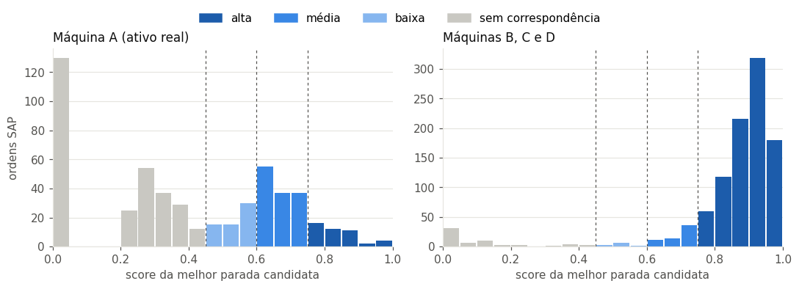

_Figura 1. Distribuição da nota de conciliação. Nas máquinas B–D a distribuição tem dois picos: ou a ordem tem um par claro (nota ≈ 0,9) ou não tem candidato. Na máquina A as notas se espalham pelo meio: os dois sistemas contam histórias diferentes._

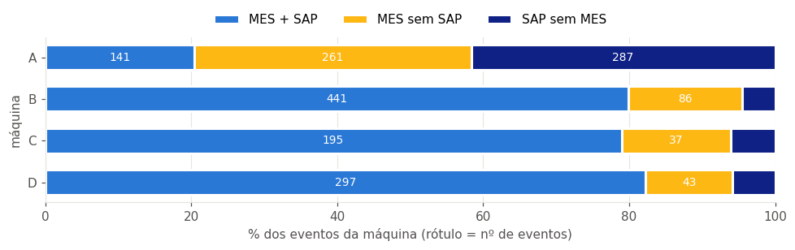

_Figura 2. Fração de eventos de cada classe por máquina. Na A, a maioria dos eventos fica sem par._

### 3.2 O vocabulário aprendido para a máquina A

Os dois sistemas usam **nomes diferentes** para o mesmo equipamento. O algoritmo aprendeu, sem tabela manual, um "dicionário bilíngue" SAP → MES:

| Nome no SAP | Equipamento no MES (% das vezes)         |
| ----------- | ---------------------------------------- |
| FORNO 1     | AQUECIMENTO 43 %, DISCO 38 %, ROLOS 14 % |
| LONAS       | LONAS 50 %, DISCO 36 %, AQUECIMENTO 9 %  |
| MAQUINA A   | AQUECIMENTO 56 %, DISCO 25 %, ROLOS 12 % |
| FORNO 2     | AQUECIMENTO 44 %, DISCO 22 %, LONAS 22 % |

"FORNO 1" é ora AQUECIMENTO, ora DISCO: por isso uma tabela de-para escrita à mão falharia. Esse dicionário é também uma proposta de padronização que a Engenharia pode validar.

### 3.3 Por que os eventos não conciliam

| Motivo provável                                                        |   A |   B |   C |   D | Total |
| ---------------------------------------------------------------------- | --: | --: | --: | --: | ----: |
| Ajuste curto: provável ação do próprio operador                        | 131 |  63 |  12 |  20 |   226 |
| Parada próxima, mas equipamento/texto incompatível                     | 157 |  14 |   6 |  11 |   188 |
| Nenhuma parada na janela: intervenção sem parada ou parada não anotada | 130 |  11 |   9 |  10 |   160 |
| Quebra sem ordem: lacuna de apontamento na manutenção                  |  86 |   9 |  12 |   9 |   116 |
| Ajuste longo sem ordem                                                 |  44 |  14 |  13 |  14 |    85 |

### 3.4 Divergências de horário

| Máquina | Eventos conciliados | Espera mediana até a atuação | SAP começa > 15 min **antes** da parada | Fila de revisão |
| ------- | ------------------: | ---------------------------: | --------------------------------------: | --------------: |
| A       |                 141 |                  **−11 min** |                                      66 |              63 |
| B       |                 441 |                        8 min |                                       4 |               8 |
| C       |                 195 |                       10 min |                                       0 |               1 |
| D       |                 297 |                       10 min |                                       1 |               3 |

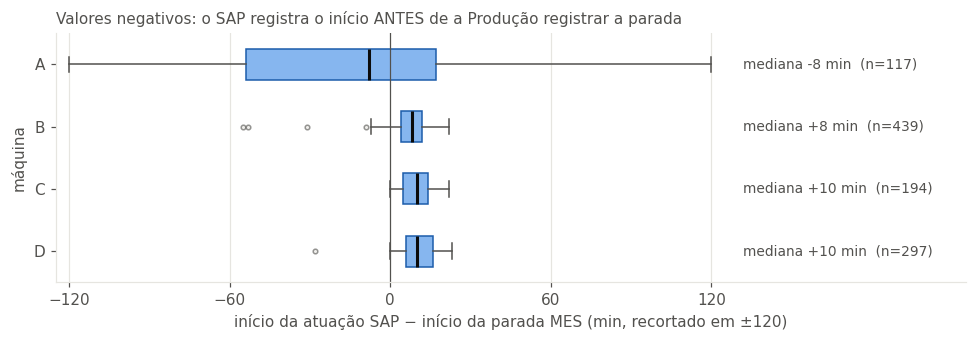

_Figura 3. Minutos entre a parada (MES) e o início do serviço (SAP). Na A, o serviço "começa antes" da parada com frequência: os horários do SAP são arredondados e anotados depois, e não servem para medir tempo de resposta._

### 3.5 A linha do tempo de um evento

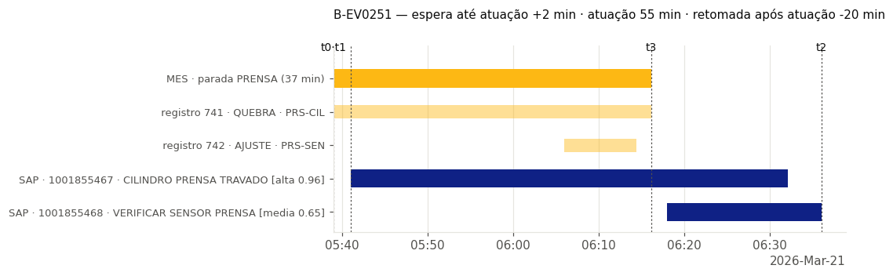

_Figura 4. Evento "limpo" (máquina B): parada e ordem praticamente coincidem._

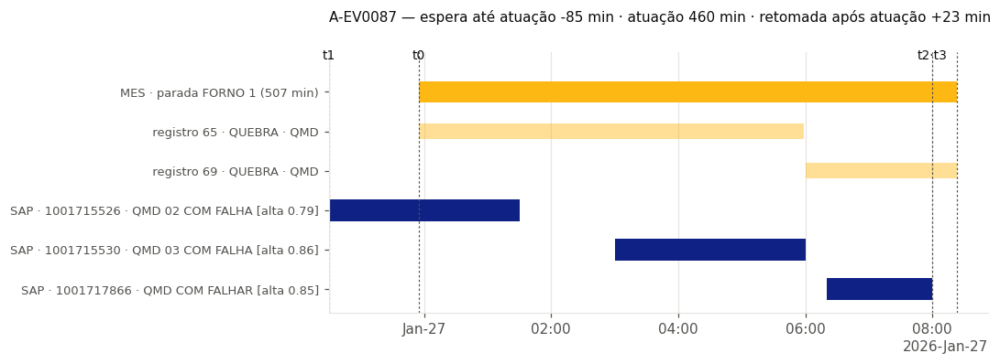

_Figura 5. Evento real da máquina A, com várias ordens ligadas à mesma parada._

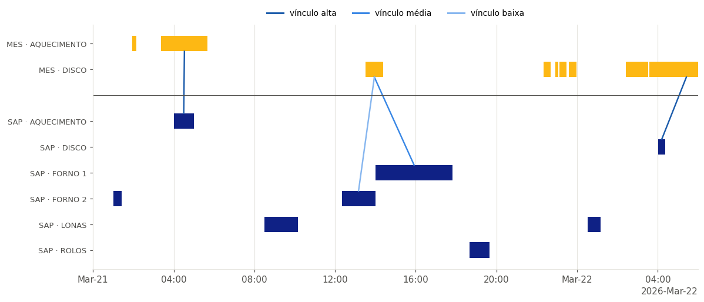

_Figura 6. Um dia da máquina A (21/03) lado a lado: em cima, as paradas do MES; embaixo, as ordens do SAP; cada traço liga uma ordem à parada escolhida, colorido pela confiança. É a visão que a reunião diária da fábrica hoje não tem._

### 3.6 Confiabilidade da conciliação

- **Sensibilidade:** variar os parâmetros do método altera **menos de 1 %** das ligações. Só o cenário "apenas horário" muda mais, o que mostra que equipamento e texto são o que desempata paradas simultâneas.
- **Robustez a ruído:** mesmo com os horários do SAP deslocados em ± 1 h, o método completo recupera **~95 %** dos pares; usando só o horário, ~80 %.

| Ruído nos horários (σ, min) | Método completo | Só horário |
| --------------------------: | --------------: | ---------: |
|                           0 |         100,0 % |     95,6 % |
|                          30 |          98,6 % |     87,8 % |
|                          60 |          94,7 % |     79,6 % |
|                         120 |          84,3 % |     64,1 % |
|                         240 |          65,1 % |     47,0 % |

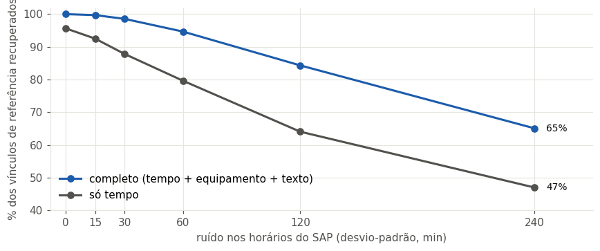

_Figura 7. Fração de pares recuperados conforme os horários do SAP pioram. Combinar as três pistas deixa o método muito mais tolerante a horários imprecisos._

- **Revisão humana:** 88 ordens foram para a fila de revisão, e uma amostra estratificada de 56 pares foi separada para auditoria.

---

## 4. Retrato de cada máquina

| Máquina   |   Paradas | Quebras | Horas paradas | % em quebra | Disponibilidade |       MTTR | Mediana do reparo |   MTBF | Quebras/semana |
| --------- | --------: | ------: | ------------: | ----------: | --------------: | ---------: | ----------------: | -----: | -------------: |
| **A**     |       402 |     163 |   **605,7 h** |      64,6 % |      **86,1 %** | **2,41 h** |            1,12 h | 22,9 h |            6,3 |
| B         |       527 |     191 |       319,6 h |      61,0 % |          92,6 % |     1,02 h |            0,68 h | 21,1 h |            7,4 |
| C         |       232 |     147 |       513,1 h |      86,6 % |          88,2 % |     3,02 h |            2,20 h | 26,1 h |            5,7 |
| D         |       340 |     208 |       518,2 h |      86,5 % |          88,1 % |     2,15 h |            1,60 h | 18,4 h |            8,0 |
| **Total** | **1.501** | **709** | **1.956,6 h** |      75,6 % |          88,7 % |     2,09 h |            1,31 h | 21,8 h |            6,9 |

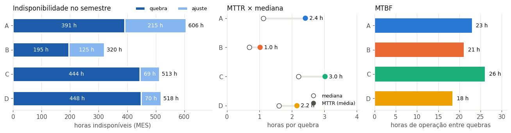

_Figura 8. Esquerda: horas paradas por máquina (quebra × ajuste). Centro: MTTR (média) × mediana do reparo. Direita: MTBF._

**Leitura:**

- A máquina **A é a que mais perde** (≈ 606 h), mas seu MTBF (≈ 23 h) está no meio do grupo. O que a diferencia é o **tempo por evento** e o peso dos **ajustes** (≈ 1/3 das horas).
- A A tem a **maior distância entre média e mediana** do reparo (2,4 h × 1,1 h): a quebra típica é curta, mas algumas são muito longas.
- MTBF de ≈ 1 dia significa que **cada máquina quebra quase todo dia**: é o tamanho do problema de "operar sempre reagindo".

---

## 5. Evolução ao longo do semestre

| Horas paradas por mês |   Jan |   Fev |   Mar |   Abr |   Mai |       Jun |
| --------------------- | ----: | ----: | ----: | ----: | ----: | --------: |
| A                     | 164,0 | 161,4 | 105,4 |  73,3 |  49,0 |      52,5 |
| B                     |  55,1 |  50,2 |  45,1 |  56,5 |  61,8 |      50,9 |
| C                     |  86,0 |  59,8 |  87,5 | 113,0 |  83,7 |      83,0 |
| D                     |  16,4 |  31,7 |  39,8 |  65,8 | 171,5 | **193,1** |

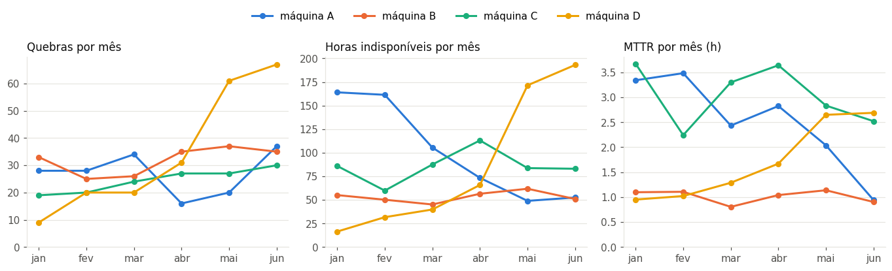

_Figura 9. Quebras, horas paradas e MTTR mês a mês, por máquina._

**Leitura:**

- **A máquina A melhorou, mas por um caminho específico.** As horas paradas caíram de ≈ 160 h/mês (jan–fev) para ≈ 50 h/mês (mai–jun), e o MTTR caiu de ≈ 3,4 h para ≈ 1 h. Mas o **número de quebras não caiu** (junho é o mês com mais quebras da A). A equipe ficou **mais rápida para consertar**; a **causa** das quebras continua.
- **A máquina D piorou de forma brusca** a partir de abril: as quebras triplicaram e as horas foram de ≈ 16 h para ≈ 190 h/mês.
- B e C ficaram estáveis.

---

## 6. Onde a perda se concentra

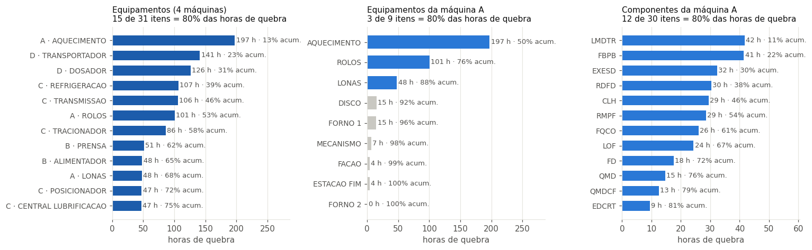

_Figura 10. Pareto das horas de quebra. Esquerda: equipamentos das quatro máquinas. Centro: equipamentos da máquina A. Direita: componentes da máquina A. As barras coloridas somam 80 % das horas._

**Leitura:**

- Na máquina A, **AQUECIMENTO sozinho responde por metade das horas de quebra** (197 h). Com ROLOS (101 h) e LONAS (48 h), chega a **88 %**. Os outros seis equipamentos somam ≈ 12 %.
- No nível de componente a perda é mais espalhada: **12 de 30 componentes** chegam a 80 %. Os três primeiros são **LMDTR, FBPB e EXESD** (30 % das horas).
- O ranking por **horas** é diferente do ranking por **número de quebras**: LMDTR, FBPB e EXESD lideram em horas; **CLH, FD e RMPF** lideram em quantidade. São dois problemas diferentes:
  - **poucas quebras longas** → atacar o tempo de reparo (peça em estoque, diagnóstico, procedimento);
  - **muitas quebras curtas e repetidas** → atacar a causa raiz.

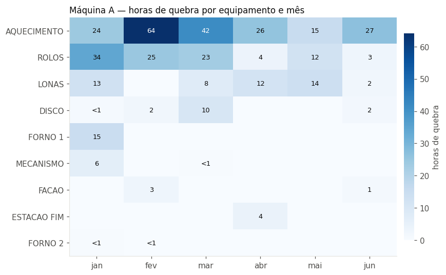

_Figura 11. Horas de quebra por equipamento e mês na máquina A._

A queda de horas da A vem principalmente de **ROLOS** (23–34 h/mês no 1º trimestre, 3–12 h/mês a partir de abril) e do pico de **AQUECIMENTO** em fevereiro–março, que não se repetiu. AQUECIMENTO, porém, continua sendo o maior consumidor de horas em quase todos os meses.

---

## 7. Tempo de reparo: a cauda longa da máquina A

| Máquina | Quebras |  Média | Mediana | Percentil 90 |  Máximo | % de quebras > 4 h | % das horas vindas de quebras > 4 h |
| ------- | ------: | -----: | ------: | -----------: | ------: | -----------------: | ----------------------------------: |
| **A**   |     162 | 2,41 h |  1,12 h |       6,22 h | 14,92 h |             19,1 % |                          **61,4 %** |
| B       |     191 | 1,02 h |  0,68 h |       2,13 h |  5,14 h |              4,2 % |                              18,9 % |
| C       |     147 | 3,02 h |  2,20 h |       6,73 h |  7,95 h |             25,2 % |                              52,1 % |
| D       |     208 | 2,15 h |  1,60 h |       4,45 h |  7,95 h |             14,9 % |                              38,9 % |

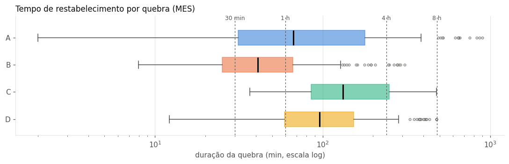

_Figura 12. Distribuição dos tempos de reparo (escala logarítmica). Linhas tracejadas em 30 min, 1 h, 4 h e 8 h._

**Leitura:** na máquina A, **≈ 19 % das quebras duram mais de 4 h e somam ≈ 61 % das horas de quebra**, a maior concentração das quatro máquinas. Uma em cada cinco quebras da A vira um evento de meio turno, e é ali que está a maior parte da perda. Descobrir o que essas quebras longas têm em comum é uma análise de causa raiz de alto retorno.

---

## 8. Reincidência: o ciclo reparo, retorno e nova falha

Uma quebra é **reincidente** quando o mesmo componente já tinha quebrado pouco antes.

| Máquina | Quebras de componente | Reincidência em 7 dias | Reincidência em 30 dias | Intervalo mediano entre quebras do mesmo componente |
| ------- | --------------------: | ---------------------: | ----------------------: | --------------------------------------------------: |
| **A**   |                   168 |             **51,8 %** |                  69,6 % |                                        **4,4 dias** |
| B       |                   191 |                 29,3 % |                  63,9 % |                                           13,6 dias |
| C       |                   149 |                 22,2 % |                  63,1 % |                                           14,7 dias |
| D       |                   214 |                 42,5 % |                  73,8 % |                                            7,1 dias |

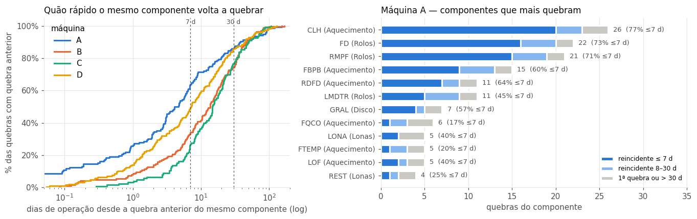

_Figura 13. Esquerda: fração acumulada das quebras em até X dias após a anterior do mesmo componente; a curva da A é a primeira a subir. Direita: os 12 componentes da A que mais quebram, separados por reincidência em até 7 dias, entre 8 e 30 dias e demais._

**Componentes com maior reincidência imediata (mínimo de 5 quebras):**

| Máquina | Equipamento     | Componente | Quebras | % em 7 dias | % em 30 dias | Intervalo mediano |
| ------- | --------------- | ---------- | ------: | ----------: | -----------: | ----------------: |
| D       | TRANSPORTADOR   | TRP-MAN    |      28 |      78,6 % |       92,9 % |          2,0 dias |
| **A**   | **AQUECIMENTO** | **CLH**    |      26 |  **76,9 %** |       88,5 % |          3,1 dias |
| **A**   | **ROLOS**       | **FD**     |      22 |  **72,7 %** |       90,9 % |          2,8 dias |
| D       | DOSADOR         | DOS-ATU    |      29 |      72,4 % |       93,1 % |          2,0 dias |
| **A**   | **ROLOS**       | **RMPF**   |      21 |  **71,4 %** |       90,5 % |          2,9 dias |
| B       | ALIMENTADOR     | ALM-COR    |      20 |      65,0 % |       95,0 % |          4,3 dias |
| A       | AQUECIMENTO     | RDFD       |      11 |      63,6 % |       81,8 % |          5,6 dias |
| A       | AQUECIMENTO     | FBPB       |      15 |      60,0 % |       86,7 % |          6,3 dias |

**Leitura:**

- **A máquina A tem a reincidência mais rápida das quatro**: metade das quebras volta no mesmo componente em até uma semana.
- Os campeões são **CLH (Aquecimento), FD e RMPF (Rolos)**: mais de 70 % das quebras de cada um voltam em até 7 dias. São quebras **curtas** (mediana < 40 min), por isso pesam pouco no Pareto de horas, mas são exatamente o ciclo "reparo, retorno, nova falha".
- Para esses componentes, **a próxima quebra é mais provável na semana seguinte ao reparo do que em qualquer outro momento**: o reparo trata o efeito, não a causa.

---

## 9. Sinais de deterioração

Foram procurados três sinais de piora: quebras mais frequentes, intervalos menores entre elas e reparos mais longos.

### 9.1 Por máquina

| Máquina | Quebras 1ª metade | Quebras 2ª metade | Tendência de frequência            | Reparos                              | Padrão de falha                | Situação    |
| ------- | ----------------: | ----------------: | ---------------------------------- | ------------------------------------ | ------------------------------ | ----------- |
| **A**   |                89 |                73 | nenhuma (U ≈ 0)                    | **mais curtos** (MTTR 3,0 h → 1,7 h) | quebras agrupadas (β ≈ 0,7)    | **estável** |
| B       |                84 |               107 | leve                               | sem mudança                          | aleatório                      | atenção     |
| C       |                62 |                85 | crescente                          | sem mudança                          | aleatório                      | alerta      |
| D       |                48 |           **160** | **fortemente crescente** (U = 8,8) | **mais longos** (1,1 h → 2,5 h)      | agrupadas, com taxa acelerando | **alerta**  |

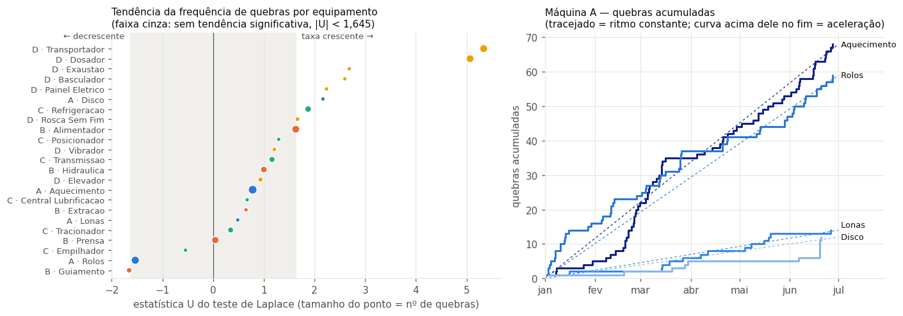

_Figura 14. Esquerda: estatística de tendência por equipamento; à direita da faixa cinza, frequência de quebras aumentando. Direita: quebras acumuladas dos principais equipamentos da máquina A em relação a um ritmo constante._

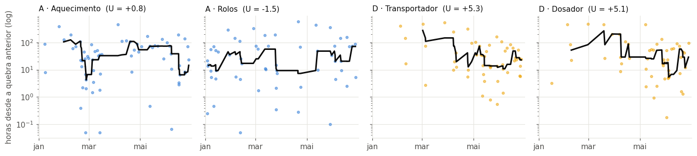

_Figura 15. Tempo de funcionamento entre quebras consecutivas, com mediana móvel. Nos equipamentos da D a linha desce de forma sustentada (deterioração); nos da A, não._

### 9.2 Por componente

Dos **74 componentes** com 4 ou mais quebras: **10 em alerta**, **19 em atenção** e **45 estáveis**. Em 500 semestres simulados sem nenhuma piora, o procedimento gerou em média só **0,07 alarme falso por semestre** (nenhum em 94 % das simulações): os 10 alertas reais são sinais de verdade.

| Máquina | Componente | Quebras 1ª metade → 2ª metade | Horas em risco nos próximos 30 dias |
| ------- | ---------- | ----------------------------- | ----------------------------------: |
| D       | TRP-MAN    | 1 → 26                        |                              26,8 h |
| **A**   | **LOF**    | 1 → 4                         |                              19,3 h |
| **A**   | **FBPB**   | 4 → 11                        |                              18,5 h |
| D       | DOS-ATU    | 5 → 22                        |                              15,1 h |
| D       | DOS-VLV    | 2 → 12                        |                              13,8 h |
| D       | DOS-SEN    | 0 → 8                         |                              13,5 h |
| D       | TRP-COR    | 3 → 10                        |                              10,9 h |
| D       | TRP-MOT    | 4 → 10                        |                               7,1 h |
| C       | REF-TUB    | 1 → 6                         |                               6,7 h |
| **A**   | **GRAL**   | 1 → 6                         |                               0,6 h |

**Leitura:**

- **A máquina A, no conjunto, não está piorando**: quebra no mesmo ritmo do início ao fim do semestre, e os reparos ficaram significativamente mais curtos.
- O padrão de falha da A é de **quebras agrupadas**: depois de uma quebra, a chance de outra logo em seguida é maior. Consequência prática: **preventiva em intervalos fixos tende a render pouco na A**; o retorno está em melhorar o reparo e eliminar a causa nos componentes reincidentes.
- Dentro da A, **FBPB** é o alerta mais relevante (quase triplicou entre os trimestres e tem muitas horas em risco). LOF e GRAL também estão em alerta, com menos volume. **DISCO** é o único equipamento da A com frequência crescente, mas com só 12 quebras: vale acompanhar, não alarmar. ROLOS vai no sentido oposto (quebrando menos).
- A piora da D, visível a olho nu, é detectada com folga em TRANSPORTADOR e DOSADOR, o que confirma que o método funciona.

---

## 10. Padrões por turno e horário

| Máquina | Quebras T1 (06–14) | T2 (14–22) | T3 (22–06) | Mediana do reparo T1 / T2 / T3 |
| ------- | -----------------: | ---------: | ---------: | ------------------------------ |
| **A**   |             **97** |         38 |         28 | 0,9 h / 1,2 h / **2,2 h**      |
| B       |                 59 |         43 |         89 | 0,8 h / 0,6 h / 0,7 h          |
| C       |                 52 |         21 |         74 | 2,2 h / 2,1 h / 2,3 h          |
| D       |                 63 |         58 |         87 | 1,5 h / 1,8 h / 1,6 h          |

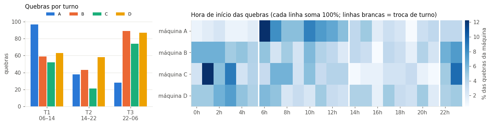

_Figura 16. Esquerda: quebras por turno e máquina. Direita: distribuição da hora de início das quebras (cada linha soma 100 %); as linhas brancas marcam as trocas de turno._

**Leitura:**

- A divisão entre turnos **não é igual** (χ² = 37,1, p ≈ 10⁻⁸). Nas máquinas B–D, o turno da noite (T3) concentra mais quebras.
- **A máquina A é a exceção:** ≈ **60 % das quebras começam no turno 1**, com pico na primeira hora do turno. Duas hipóteses, que os dados sozinhos não separam:
  1. **operacional:** partida ou troca de produto no início do dia, condição de temperatura (AQUECIMENTO é o maior ofensor);
  2. **de anotação:** no turno 1 a manutenção está presente e a parada vira QUEBRA; à noite, o mesmo problema pode ser resolvido pelo operador e anotado como AJUSTE.
- As quebras da A no turno 3 são **mais longas** (mediana 2,2 h contra 0,9 h no turno 1), o que reforça a hipótese 2: à noite só vira "quebra" o que o operador não resolve sozinho.

---

## 11. O que só aparece com MES e SAP juntos

### 11.1 Cobertura: quanto da perda tem registro da Manutenção?

| Máquina | Tipo de parada | Com ordem (confiança alta/média) | Com ordem (confiança baixa) | **Sem ordem** |
| ------- | -------------- | -------------------------------: | --------------------------: | ------------: |
| **A**   | Ajuste         |                           49,1 % |                       8,2 % |    **42,7 %** |
| **A**   | Quebra         |                           72,6 % |                       3,0 % |    **24,3 %** |
| B       | Quebra         |                           94,3 % |                       0,0 % |         5,7 % |
| C       | Quebra         |                           94,8 % |                       0,0 % |         5,2 % |
| D       | Quebra         |                           94,9 % |                       0,0 % |         5,1 % |

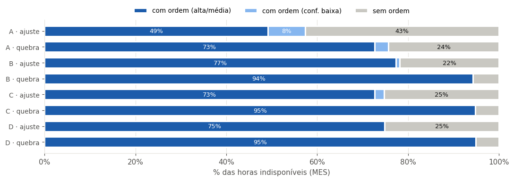

_Figura 17. Fração das horas de parada com e sem ordem SAP, por máquina e tipo de parada._

Nas máquinas B–D, ≈ 95 % das horas de quebra têm ordem. Na **máquina A, ≈ 24 % não têm**: são ≈ **95 h de quebra sem nenhum registro da manutenção** no semestre. Um quarto da perda por quebra da máquina principal não tem descrição do que foi feito e, por isso, nunca entra numa análise de falha.

### 11.2 Para onde vai o tempo de uma parada

| Máquina | Eventos | Espera até a atuação | Atuação da manutenção | **Restante (sem ordem)** | Espera mediana | Atuação mediana | Parada mediana |
| ------- | ------: | -------------------: | --------------------: | -----------------------: | -------------: | --------------: | -------------: |
| **A**   |     112 |                 12 % |                  59 % |                 **29 %** |        0 min\* |          84 min |        132 min |
| B       |     439 |                 22 % |                  77 % |                    ≈ 1 % |          8 min |          17 min |         25 min |
| C       |     194 |                ≈ 7 % |                  93 % |                    ≈ 0 % |         10 min |          85 min |         98 min |
| D       |     297 |                 11 % |                  89 % |                    ≈ 0 % |         10 min |          51 min |         65 min |

\* Na A, o SAP frequentemente registra o início **antes** da parada (horários arredondados e anotados depois). A espera de "0 min" não significa resposta instantânea: significa que o horário do SAP da A não serve para medir tempo de resposta.

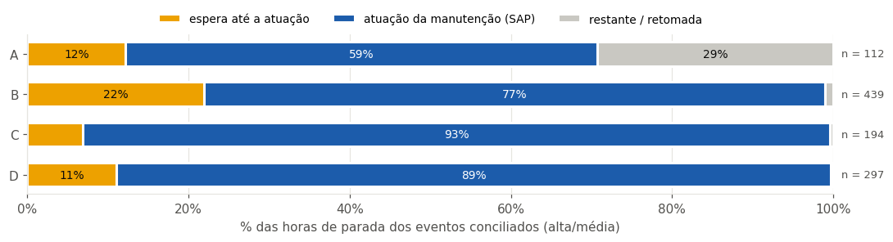

_Figura 18. Divisão das horas de parada em espera, atuação registrada no SAP e restante._

Na **máquina A, ≈ 29 % das horas de parada ficam fora de qualquer ordem**: a máquina está parada, mas não há serviço registrado. Pode ser espera por peça, por pessoa, teste, liberação ou serviço não anotado; os dados não dizem qual.

### 11.3 Os números que "nunca fecham"

| Máquina | Horas MES | Horas SAP | SAP ÷ MES | Ordens > 24 h | Horas dessas ordens | SAP ÷ MES sem elas |
| ------- | --------: | --------: | --------: | ------------: | ------------------: | -----------------: |
| **A**   |     605,7 |   1.479,7 |  **2,44** |         **9** |           **605,0** |           **1,44** |
| B       |     319,6 |     292,0 |      0,91 |             0 |                   0 |               0,91 |
| C       |     513,1 |     507,6 |      0,99 |             0 |                   0 |               0,99 |
| D       |     518,2 |     494,8 |      0,95 |             0 |                   0 |               0,95 |

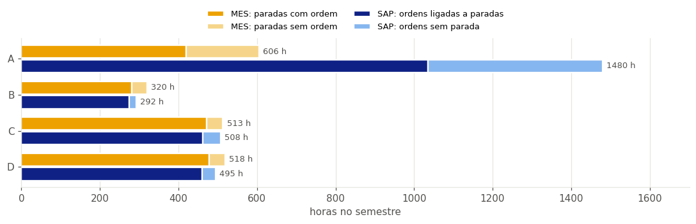

_Figura 19. Horas atribuídas por cada sistema, separadas em "com par" e "sem par"._

Em B, C e D os dois sistemas fecham com diferença de até 10 %. Na A, o SAP registra ≈ **2,4×** as horas do MES, e a maior parte dessa diferença vem de **apenas 9 ordens deixadas abertas por mais de 24 h**, que somam praticamente toda a indisponibilidade da A. A "discussão sobre qual número é o verdadeiro" é causada, em grande parte, por um punhado de ordens esquecidas, e não por uma divergência sistemática.

### 11.4 O texto das ordens não explica a falha (máquina A)

| Indicador (521 ordens da A)                |    Valor |
| ------------------------------------------ | -------: |
| Modo de falha identificado                 |     39 % |
| Objeto (peça/componente) identificado      |     78 % |
| **Texto pobre** (falta modo **ou** objeto) | **69 %** |

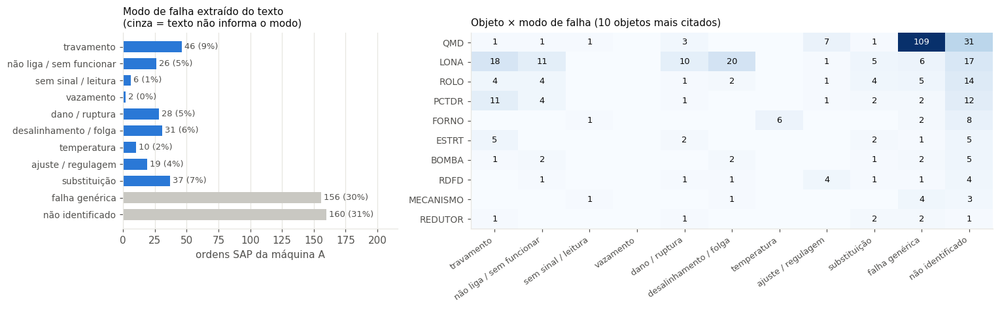

_Figura 20. Esquerda: ordens por modo de falha (em cinza, as que não dizem como falharam). Direita: objetos mais citados × modo de falha._

**Leitura:**

- **61 % das ordens da A não dizem como o equipamento falhou** (30 % só dizem "falha"/"problema"/"verificar"; 31 % nem isso).
- O caso mais claro é o **QMD**: é o objeto mais citado (≈ 150 ordens) e, em ≈ 109 delas, o texto é só uma variação de "QMD em falha". **O componente que mais aparece no SAP é justamente o que menos se explica.**
- **LONA** é o contraexemplo: tem modos de falha descritos (desalinhamento, travamento, não liga, dano), exatamente o tipo de registro que permite agrupar falhas pela causa.

---

## 12. Efetividade das intervenções planejadas

**A base do SAP não contém nenhuma ordem preventiva.** Os únicos tipos são:

| Tipo de ordem       |     A |     B |     C |     D | Total |
| ------------------- | ----: | ----: | ----: | ----: | ----: |
| Corretiva           |   110 |   111 |    95 |   134 |   450 |
| Corretiva planejada |   411 |   366 |   121 |   199 | 1.097 |
| **Preventiva**      | **0** | **0** | **0** | **0** | **0** |

Sem o histórico de preventivas, a efetividade do plano **não pode ser medida diretamente**. A comparação possível é entre intervenção **planejada** e **emergencial**: depois de cada uma, quanto tempo o componente aguenta até quebrar de novo?

| Grupo        | Tipo        | Intervenções | % sem nova quebra em 30 dias | Dias médios sem quebra no 1º mês |
| ------------ | ----------- | -----------: | ---------------------------: | -------------------------------: |
| Máquina A    | Emergencial |           21 |                         60 % |                             21,1 |
| Máquina A    | Planejada   |           86 |                         60 % |                             21,9 |
| Máquinas B–D | Emergencial |          308 |                         28 % |                             15,5 |
| Máquinas B–D | Planejada   |          621 |                         32 % |                             16,8 |

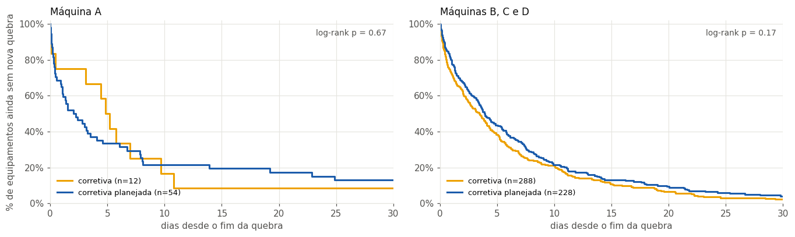

_Figura 21. Fração dos equipamentos ainda sem nova quebra nos dias seguintes à intervenção, por tipo de ordem._

**Leitura:**

- Das 1.036 intervenções analisadas, **80 % tiveram nova quebra no mesmo componente** dentro do período.
- A diferença entre planejada e emergencial **não é significativa** (p = 0,18): a intervenção planejada não prolonga de forma mensurável o tempo até a próxima falha.
- Em todos os grupos, **entre 2/3 e 3/4 dos equipamentos quebram de novo em até uma semana**, seja qual for o tipo de intervenção. Isso é coerente com reparos que tratam o sintoma, e reforça o achado de reincidência.

---

## 13. Ranking de priorização

Pergunta do case: _se a Engenharia puder atacar apenas alguns problemas neste período, quais deveriam ser priorizados e por quê?_

O ranking combina **impacto** (horas paradas × criticidade da máquina), **frequência**, **tendência de piora** e **reincidência**. Os pesos, definidos por comparação par a par entre os critérios, foram Impacto 46 %, Frequência 26 %, Tendência 14 % e Reincidência 14 %, com julgamentos coerentes entre si (razão de consistência 0,004, limite 0,10).

### 13.1 Por equipamento

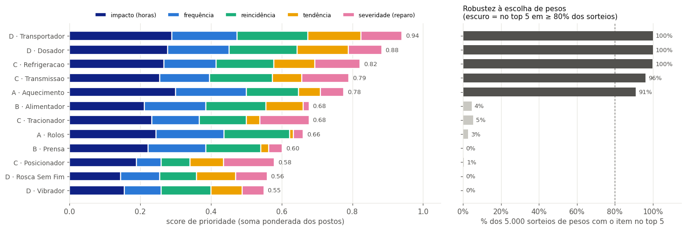

_Figura 22. Esquerda: score de prioridade de cada equipamento, dividido pela contribuição de cada critério. Direita: em quantos de 5.000 conjuntos de pesos alternativos o equipamento fica no top 5; barras escuras são prioridades que não dependem da discussão sobre pesos._

Cinco equipamentos ficam no top 5 em **mais de 90 %** dos sorteios: D·Transportador, D·Dosador, C·Refrigeração, C·Transmissão e **A·Aquecimento**. Na máquina A, **AQUECIMENTO** lidera em impacto e frequência. ROLOS (A) cai para 8º porque suas quebras estão **diminuindo**: o ranking valoriza o que vai piorar, e não só o que foi ruim.

Considerando a criticidade da máquina (a A é o gargalo, sem máquina reserva), o ranking por equipamento coloca **A·AQUECIMENTO em 1º lugar** (score 91), à frente de D·Transportador (67) e D·Dosador (63).

### 13.2 Por componente (top 15 do semestre)

| Posição | Máquina | Componente |    Score | Quebras | Horas |   MTTR | Reincidentes (≤ 7 d) | % dos sorteios no top 10 |
| ------: | ------- | ---------- | -------: | ------: | ----: | -----: | -------------------: | -----------------------: |
|       1 | D       | TRP-MAN    |     96,5 |      27 |  73,6 | 2,73 h |                   21 |                    100 % |
|       2 | D       | DOS-ATU    |     80,6 |      27 |  50,2 | 1,86 h |                   18 |                    100 % |
|   **3** | **A**   | **FBPB**   | **79,8** |      15 |  48,6 | 3,24 h |                    9 |                **100 %** |
|   **4** | **A**   | **CLH**    | **69,0** |      25 |  31,7 | 1,27 h |                   19 |                **100 %** |
|   **5** | **A**   | **LMDTR**  | **62,7** |      11 |  42,1 | 3,83 h |                    5 |                 **98 %** |
|       6 | D       | DOS-VLV    |     62,1 |      14 |  43,0 | 3,07 h |                    8 |                    100 % |
|       7 | C       | TRM-EIX    |     57,6 |      15 |  37,4 | 2,49 h |                    7 |                     99 % |
|       8 | D       | TRP-COR    |     56,2 |      13 |  40,5 | 3,12 h |                    4 |                     77 % |
|       9 | A       | FD         |     53,8 |      22 |  17,6 | 0,80 h |                   15 |                     45 % |
|      10 | A       | RDFD       |     53,7 |      10 |  40,0 | 4,00 h |                    6 |                     51 % |
|      11 | A       | RMPF       |     53,5 |      19 |  28,2 | 1,48 h |                   13 |                     52 % |
|      12 | C       | REF-BMB    |     52,6 |      11 |  37,8 | 3,43 h |                    4 |                     29 % |
|      13 | D       | TRP-MOT    |     51,7 |      14 |  24,9 | 1,78 h |                    9 |                     22 % |
|      14 | B       | ALM-COR    |     50,9 |      20 |  15,5 | 0,77 h |                   13 |                     18 % |
|      15 | C       | TRM-RED    |     50,2 |      13 |  48,3 | 3,72 h |                    2 |                      7 % |

**Estabilidade do ranking:** em 2.000 variações dos pesos, a ordem do ranking fica praticamente igual à original (correlação mediana de **0,99**; acima de 0,96 mesmo nos 5 % de sorteios mais diferentes). Dos 10 primeiros, **7 ficam no top 10 em pelo menos 90 % das variações**.

**O que o ranking muda em relação a um Pareto de horas:** entram no top 10 **A·FD** e **C·TRM-EIX** (quebram muito e reincidem); saem **A·EXESD** e **C·TRM-RED** (muitas horas, mas poucas quebras e sem piora).

### 13.3 Ranking dinâmico (janela móvel de 90 dias)

| Componente   | 01/04 | 01/05 | 01/06 | 28/06 |
| ------------ | ----: | ----: | ----: | ----: |
| D · TRP-MAN  |    90 |     8 | **1** | **1** |
| D · DOS-ATU  |    21 |    25 |     2 |     2 |
| D · DOS-VLV  |    66 |    75 |     4 |     3 |
| D · TRP-COR  |    41 |    28 |     9 |     4 |
| **A · FBPB** | **5** | **2** |    10 |     5 |
| D · TRP-MOT  |    16 |    58 |    19 |     6 |
| C · TRM-EIX  |    11 |    30 |    14 |     7 |
| C · REF-BMB  |    13 |    14 |     5 |     8 |
| D · DOS-SEN  |     — |    53 |    22 |     9 |
| **A · CLH**  | **2** | **1** |     3 |    10 |

Recalculado a cada mês sobre os últimos 90 dias, o ranking mostra a máquina **D** passando de **0 para 6 itens no top 10** entre abril e junho, acompanhando a piora vista na seção 5. **FBPB** e **CLH**, da máquina A, permanecem no topo em todos os cortes.

### 13.4 Por máquina

| Posição | Máquina | Score | Quebras | Horas |   MTTR | Reincidentes | Tendência   |
| ------: | ------- | ----: | ------: | ----: | -----: | -----------: | ----------- |
|       1 | D       |  82,6 |     208 | 448,2 | 2,15 h |           84 | forte piora |
|       2 | **A**   |  81,8 |     162 | 391,0 | 2,41 h |           82 | estável     |
|       3 | C       |  71,5 |     147 | 444,1 | 3,02 h |           29 | piora       |
|       4 | B       |  56,9 |     191 | 194,9 | 1,02 h |           55 | leve        |

---

## 14. Conclusões e recomendações

### O diagnóstico da máquina A

1. **O problema é crônico, não de piora.** A A não quebra mais com o tempo; ela quebra **sempre igual**, e metade das quebras volta no mesmo componente em até uma semana.
2. **O reparo melhorou, a causa não.** O MTTR caiu pela metade no semestre, mas o número de quebras se manteve. A equipe é eficiente no sintoma.
3. **A perda é muito concentrada.** Três equipamentos (AQUECIMENTO, ROLOS, LONAS) somam 88 % das horas de quebra; as quebras longas (> 4 h) são 1 em cada 5, mas valem 61 % das horas.
4. **Os sistemas contam histórias diferentes.** 24 % das horas de quebra não têm ordem; 29 % do tempo de parada conciliado fica fora de qualquer serviço registrado; 69 % dos textos não permitem análise de falha; e 9 ordens esquecidas abertas explicam a maior parte da divergência de horas entre MES e SAP.
5. **Não há como avaliar o plano preventivo** com os dados atuais, e a intervenção planejada não se mostrou mais efetiva do que a emergencial.

### O que a Engenharia deveria atacar primeiro (máquina A)

| Prioridade | Alvo                          | Por quê                                                                                                                        | Tipo de ação                                              |
| ---------- | ----------------------------- | ------------------------------------------------------------------------------------------------------------------------------ | --------------------------------------------------------- |
| 1          | **AQUECIMENTO** (equipamento) | Metade das horas de quebra da A; 1º no ranking de equipamentos                                                                 | Plano de ação dedicado                                    |
| 2          | **FBPB** (Aquecimento)        | 1º componente da A no ranking; em alerta de deterioração (4 → 11 quebras entre os trimestres); 87 % de reincidência em 30 dias | Análise de causa raiz                                     |
| 3          | **CLH** (Aquecimento)         | Maior reincidência imediata da A (≈ 77 % em 7 dias); 25 quebras                                                                | Eliminar a causa do ciclo de retorno                      |
| 4          | **LMDTR** (Rolos)             | Maior consumidor de horas entre os componentes da A; reparo longo (MTTR 3,8 h)                                                 | Reduzir tempo de reparo (peça, diagnóstico, procedimento) |
| 5          | **FD, RMPF** (Rolos)          | > 70 % de reincidência em 7 dias, quebras curtas                                                                               | Causa raiz                                                |

### Recomendações de processo

- **Priorizar causa raiz em vez de preventiva por tempo** na máquina A: o padrão de quebras agrupadas indica que encurtar o intervalo entre preventivas tende a render pouco.
- **Fechar as ordens no fim do atendimento** (ou separar tempo de serviço de tempo de calendário): resolve a maior parte da divergência de horas MES × SAP.
- **Tornar obrigatório o modo de falha** quando o texto da ordem for genérico, começando pelo QMD.
- **Registrar o acionamento da manutenção de forma digital**, com um número comum aos dois sistemas e etapas de status (aberto → em atendimento → aguardando peça → liberado). Isso elimina a necessidade de conciliação e torna visível o tempo hoje "sem ordem".
- **Registrar as preventivas no SAP** (plano, data de execução, componente e resultado), para que a efetividade do plano possa ser medida.
- **Conversar com os líderes de turno** sobre a concentração de quebras da A no início do turno 1, para separar causa operacional de diferença de anotação.

---

## 15. Limitações

- **Máquinas B, C e D parecem simuladas.** Validam os métodos, mas as conclusões de engenharia valem para a A.
- **Seis meses de histórico.** Suficiente para Pareto, MTTR, MTBF e reincidência; curto para tendências suaves ou sazonais.
- **Sem gabarito para a conciliação.** A confiança de cada ligação é uma nota construída, não uma probabilidade medida; a auditoria humana é o caminho para medir o acerto real.
- **O MTTR do MES não é o tempo de conserto.** É o tempo até a máquina voltar a produzir, incluindo espera e retomada.
- **Sem dados de custo.** O impacto é medido em horas ponderadas pela criticidade da máquina.
- **A comparação planejada × emergencial é observacional** e sujeita a viés de seleção: indica, mas não prova, causa e efeito.

---

## 16. Estrutura do repositório

```
moura_manutencao/
├── README.md
├── requirements.txt
└── src/
    ├── 01 - Processamento Inicial.ipynb     # limpeza e validação das bases MES e SAP
    ├── 02 - Conciliação MES e SAP.ipynb      # ligação entre paradas e ordens de serviço
    ├── 03 - Análise de Indicadores.ipynb     # indicadores, Pareto, reincidência, deterioração
    ├── 04 - Estudo de Priorização.ipynb      # ranking, alertas e efetividade das intervenções
    ├── scripts/
    │   ├── conciliacao.py                   # algoritmo de conciliação
    │   └── priorizacao.py                   # regras de ranking e deterioração
    ├── data/raw/base.xlsx                   # base original
    └── figuras/                             # figuras usadas neste README
```

### Como reproduzir

```bash
python -m venv .venv
.venv\Scripts\activate          # Windows  (Linux/macOS: source .venv/bin/activate)
pip install -r requirements.txt
```

Execute os notebooks de `src/` **na ordem numérica**, a partir da pasta `src/`. Cada notebook lê as saídas do anterior em `src/data/processed/` e salva as figuras em `src/figuras/`.
